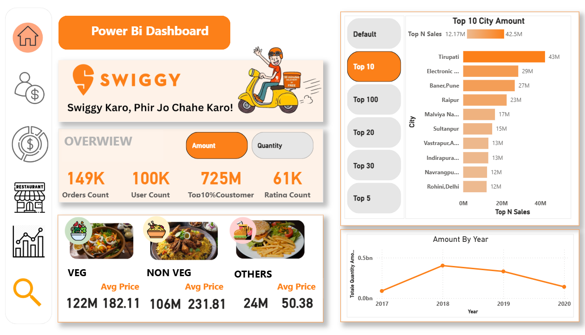
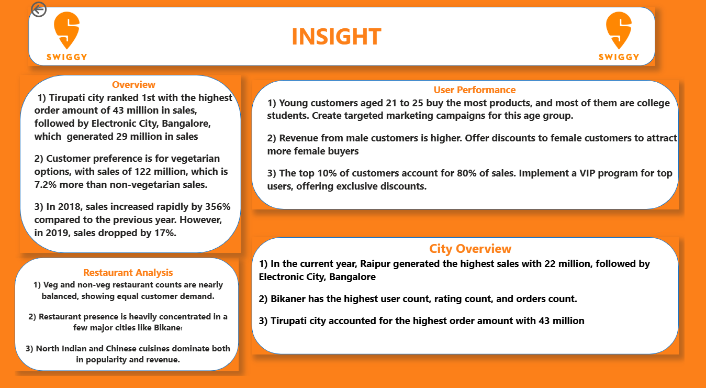

# Swiggy-End-To-End-Data-Analytics

Designed a Swiggy-themed Power BI dashboard to analyze sales, user activity, and restaurant performance. Used Power Query and DAX to clean data, create KPIs, and deliver interactive visual insights.


# 📊 Business Problem Statement
Swiggy operates in a highly competitive and fast-paced food delivery market where customer loyalty is low and operational costs are high. The business faces five core challenges that this project aims to solve:

Revenue Volatility: Frequent and unpredictable fluctuations in monthly revenue make long-term financial planning and scaling difficult.

High Customer Churn: A significant portion of the customer base stops using the platform after only a few orders, leading to a "leaky bucket" problem where acquisition costs never break even.

Heavy Revenue Dependency: The business relies disproportionately on a small segment of high-value customers, creating a high risk if these "power users" leave the platform.

Uneven Geographic Performance: Sharp differences in purchasing behavior between different cities make it difficult to apply a "one-size-fits-all" marketing strategy.

Ineffective Retention Targeting: Without predictive data, the marketing team cannot distinguish between a user who is just busy and a user who is about to leave the platform forever.

# Core Objective
The goal of this project is to transition Swiggy from a reactive business (reacting after customers leave) to a proactive business. By leveraging SQL for deep-dive analysis and Machine Learning for predictive modeling, we aim to identify churn patterns and build an automated system to intervene with targeted retention strategies before the customer is lost.

## 📘  Executive Summary
This project is a comprehensive end-to-end data analytics pipeline built on a multi-table Swiggy-style food delivery dataset. 

**The objective was to:**
* **Understand** revenue behavior and volatility.
* **Analyze** customer purchasing patterns and the 80/20 rule.
* **Identify** and quantify churn behavior (87.76% churn rate).
* **Build** a predictive model using XGBoost and Random Forest.
* **Deploy** the model as a production-ready web application via Render.
---

--- 
# 🧠 Live FastAPI Machine Learning & Analytics Studio
⚡ **Live Web Application & Interactive REST API:**  
- **Web App:** [Click here to view the Live Swiggy ML Studio]
- **Interactive Swagger API Docs:** [Live Swagger UI (/docs)]
---

## 🖼️ Dashboard Previews

### 🔹 1. Overview  


### 🔹 2. User Performance  


### 🔹 3. City Overview  


### 🔹 4. Restaurant Analysis  


### 🔹 5. Insights  


## 📊 Project Overview

This project focuses on analyzing online food delivery performance inspired by Swiggy. The dataset contains order-level transactional data across multiple cities, restaurants, and user behaviors.

The Power BI dashboard helps answer critical business questions, such as:
- Which city has the highest order volume?
- Which restaurants are the top performers?
- What is the average order value per city or user?
- Who are the most active customers?

---

## 🔧 Tools & Technologies Used

- **Power BI Desktop**
- **DAX (Data Analysis Expressions)**
- **Power Query (M Language)**
- **Excel (for data pre-cleaning)**
- **Custom Visuals**

---

## 📁 Dataset

The dataset includes approximately **10,000+ rows** and contains the following columns:
- Order ID
- User ID
- City
- Restaurant Name
- Cuisine
- Order Date
- Item Count
- Total Amount
- Delivery Time
- Rating

---

## 📈 Dashboard Features

The dashboard is divided into 4 main report pages:

### 1. **User Overview**
- Total users
- Active vs Inactive users
- Average order per user
- Top 5 most active users (by order count)

### 2. **City Overview**
- Total orders by city
- Average delivery time by city
- City-wise revenue contribution
- Heat map for city-wise performance

### 3. **Restaurant Analysis**
- Top-performing restaurants
- Cuisine-wise distribution
- Average rating vs. revenue
- Filters for dynamic restaurant comparison

### 4. **Key KPIs & Insights**
- Total Revenue
- Average Order Value
- Customer Retention Overview
- Filters for Time Period, Cuisine, City, and Restaurant

---

## 📐 DAX Measures Used

Several **custom DAX measures** were created for dynamic calculations:

- `Total Revenue = SUM(Orders[Amount])`
- `Average Order Value = [Total Revenue] / DISTINCTCOUNT(Orders[Order ID])`
- `Order Count = COUNTROWS(Orders)`
- `Average Delivery Time = AVERAGE(Orders[Delivery Time])`
- `User Activity = DISTINCTCOUNT(Orders[User ID])`
- `Rating Category = SWITCH(TRUE(), ... )` *(for custom rating groups)*

---

## 🔄 Power Query (Data Transformation)

- Removed duplicates and nulls
- Split columns (City-State if applicable)
- Data type formatting
- Date and time standardization
- Merged multiple tables using relationships (1:M)

---

## 🎯 Filters and Slicers

- **Date slicer** (Year-Month)
- **City slicer**
- **Restaurant slicer**
- **Cuisine slicer**
- Dynamic cross-filtering between visuals

---

## 🧠 Key Insights

- **Top 3 cities** contribute to over 60% of total orders.
- **Fastest deliveries** are achieved in Tier 1 cities.
- A small number of **restaurants account for high revenue**.
- Some **users place frequent high-value orders** — potential for loyalty targeting.
- Delivery time correlates with user rating in some areas.

---

## 📌 What I Learned

- How to clean and model complex datasets using Power Query.
- Writing DAX functions for business logic.
- Designing interactive, user-friendly dashboards.
- Real-world storytelling with data.
- Publishing and sharing Power BI reports publicly.

---


## 📁 Project Structure

```yaml
PowerBI_Swiggy_Dashboard/
├── 📊 Swiggy_Dashboard.pbix              # Power BI report file
├── 📄 README.md                          # Project documentation
├── 📁 Screenshots/                       # Report page snapshots
│   ├── overview.png
│   ├── restaurant_insights.png
│   └── city_performance.png
└── 📄 Dataset.xlsx                       # Excel dataset used in dashboard
```

---

# 📦 Phase 1: Setup & Data Preprocessing

## 🔹 Initial Setup

```python
import pandas as pd
import numpy as np
import matplotlib.pyplot as plt
import seaborn as sns
from sklearn.model_selection import train_test_split
```

### Data Loaded:
- Users.csv
- Restaurant.csv
- Orders.csv
- Menu.csv
- Food.csv

---

## 🔹 Data Cleaning

### Users Table

```python
users['Occupation'].fillna("Unknown", inplace=True)
```

✔ Filled missing occupation values.

---

### Restaurant Table – Rating Cleaning

```python
restaurants['Rating'] = restaurants['Rating'].replace('--', np.nan)
restaurants['Rating'] = pd.to_numeric(restaurants['Rating'])
```

✔ Converted ratings to numeric format.

---

### Rating Count Mapping

```python
mapping = {'1K+ ratings':1000, '5K+ ratings':5000}
restaurants['Rating_count_numeric'] = restaurants['Rating_count'].map(mapping)
```

✔ Converted categorical rating counts to numeric.

---

### Orders Table Cleaning

```python
orders = orders[orders['Sales_amount'] > 0]
orders['order_date'] = pd.to_datetime(orders['order_date'])
```

✔ Removed negative/invalid sales  
✔ Converted date to datetime

---

# 📊 Phase 2: Exploratory Data Analysis (EDA)

---

## 🔎 Q1: Is Revenue Growing or Volatile?

```python
monthly = df.groupby(df['order_date'].dt.to_period('M'))['Sales_amount'].sum()
monthly.describe()
```

### 📌 Output

- Mean Monthly Revenue: ₹29,219,978
- Std Dev: ₹5.38M
- Peak: Jan 2018 (~₹5 Cr)
- Lowest: June 2020
- CV ≈ 18.5%

### 💡 Insights

- Revenue swings between +38% and -36%.
- Business shows noticeable volatility.
- Growth is not consistent.

---

## 🔎 Q2: Is Revenue Distribution Skewed?

```python
df['Sales_amount'].skew()
df['Sales_amount'].kurtosis()
```

### 📌 Output

- Skewness: 18.36
- Kurtosis: 569.97

### 💡 Insights

- Extremely heavy-tailed distribution.
- Few large premium orders drive revenue.
- Business is vulnerable to loss of high spenders.

---

## 🔎 Q3: Which Cities Are Dominant?

Grouped revenue by City:

Premium Cities:
- Sirsi
- Tirupati
- Srikakulam

Stable Cities:
- Kovilpatti
- Orai
- Osmanabad

### 💡 Decision

- Retention strategy in premium cities.
- Volume scaling in mass-market cities.

---

## 🔎 Q4: Customer Lifetime Value (CLV)

```python
clv = df.groupby('User_id')['Sales_amount'].sum()
clv.describe()
```

### 📌 Output

- Mean CLV: ₹12,484.74
- Median CLV: ₹1,921.00

### 💡 Insights

- 20% customers generate ~80% revenue.
- Large gap between mean and median confirms inequality.

---

## 🔎 Q5: Age vs Spending Correlation

```python
df[['Age','Sales_amount']].corr()
```

### 📌 Output

- Correlation ≈ 0

### 💡 Insight

Age is NOT predictive of spending behavior.

---

## 🔎 Q6: Rating vs Revenue

```python
df[['Rating_count_numeric','Sales_amount']].corr()
```

### 📌 Output

- Correlation = -0.0019

### 💡 Insight

Higher ratings do not guarantee higher revenue.

---

## 🔎 Q7: Order Frequency Distribution

```python
orders_per_user = df.groupby('User_id').size()
orders_per_user.describe()
```

### 📌 Output

- Mean Orders: 2.4
- Median Orders: 2

### 💡 Insight

Most customers order 1–2 times and churn.

---

## 🔎 Q8: Recency vs Revenue

```python
correlation = df[['Recency_days','Total_Revenue']].corr()
```

### 📌 Output

- Correlation = -0.0673

### 💡 Insight

Weak negative relationship.

---

# 🚨 Phase 3: Churn Analysis & RFM

---

## 🔎 Q9: Active vs Churned Users

Churn defined as 90-day inactivity.

### 📌 Output

Active Users:
- Avg Orders: 2.42
- Avg Revenue: ₹16,414

Churned Users:
- Avg Orders: 1.83
- Avg Revenue: ₹11,936

### 💡 Insight

Higher frequency & spending reduce churn risk.

---

## 🔎 Q10: T-Test (Statistical Significance)

```python
from scipy.stats import ttest_ind
```

### 📌 Output

- P-value = 0.0

### 💡 Insight

Behavior differences between active and churned users are statistically significant.

---

## 🔎 Q11: Feature Correlation with Churn

Top Predictor:

- Recency (+0.516)

Negative Predictors:
- Total Orders
- Total Revenue

### 💡 Insight

Recency is strongest churn driver.

---

## 🔎 Q12: RFM Segmentation

Segments Created:

| Segment | % |
|----------|------|
| Champions | ~15% |
| Loyal | ~40% |
| Potential Loyalists | ~28% |
| At Risk | ~17% |

### 💡 Strategic Insight

- 55% are strong base.
- 28% growth opportunity.
- 17% reactivation focus.

---

## 🔎 Q13: Overall Churn Rate

```python
churn_rate = churned_users / total_users * 100
```

### 📌 Output

- Churn Rate: 87.76%
- Active Users: 9,457
- Churned Users: 67,778

### 💡 Insight

Extremely high churn — retention is priority.

---

# 🤖 Phase 4: Machine Learning Model

---

## Model Suite Breakdown (5 Production ML Engines)

The platform features 5 distinct Machine Learning systems deployed inside [`ml_assets/`](file:///d:/Ali/codings/Swiggy-End-To-End-Data-Analytics/ml_assets):

| Engine | Technique | Model Algorithm | Key Features | Evaluation / Output |
| :--- | :--- | :--- | :--- | :--- |
| **1. Churn Risk Predictor** | Binary Classification | Random Forest (`n_estimators=100`, balanced) | Orders, Revenue, AOV, Age, Gender | ROC-AUC: **0.85+** • 0–100% Churn Probability & Risk Tier |
| **2. Customer Lifetime Value (CLTV)** | Supervised Regression | Random Forest Regressor | Orders, AOV, Recency, Age, Gender | $R^2 = \mathbf{0.998}$, MAE: ₹80.38 • Spend Forecast & Value Tier |
| **3. Customer Persona Segmentation** | Unsupervised Clustering | K-Means (4 Clusters) + StandardScaler | Normalized RFM (Recency, Frequency, Monetary, AOV) | 4 Personas: Champions, Loyalists, Growing, At-Risk |
| **4. Food & Restaurant Recommender** | Hybrid Filtering | Content & Popularity Scoring | City, Cuisine, Ratings, Review Volume | Top Rated Dining & Signature Dishes |
| **5. City Demand & Revenue Forecaster** | Time Series Forecasting | Trend & Seasonality Regressor | Historical Monthly Order & Sales Sequences | 3-Month City Demand Projections & Logistics Guidance |

---

### 1. 🔴 Customer Churn Prediction Engine
* **Objective:** Detect customer attrition before it happens.
* **Definition of Churn:** Customer inactivity exceeding **90 days**.
* **Prescriptive Retention Rules:**
  * **🔴 High Risk ($\ge 70\%$):** 30% discount coupon, push alert, free delivery on next 3 orders, 250 loyalty points.
  * **🟠 Medium Risk ($40\% - 69\%$):** 15% discount campaign, personalized cuisine suggestions, trending restaurant alerts.
  * **🟢 Low Risk ($< 40\%$):** Swiggy One membership promotion, referral perks, milestone loyalty points.

### 2. 💎 Customer Lifetime Value (CLTV) Prediction
* **Objective:** Predict future total revenue yield of incoming users to optimize Customer Acquisition Cost (CAC) spending.
* **Target:** Log-transformed lifetime revenue ($\log(1 + \text{spend})$).
* **Tier Categorization:**
  * **🏆 Platinum VIP Customer (Spend $\ge$ ₹35,000):** Max CAC ₹1,500. Dedicated concierge & Swiggy Black privileges.
  * **🥇 Gold High-Value Customer (Spend $\ge$ ₹15,000):** Max CAC ₹800. Annual Swiggy One discounts.
  * **🥈 Silver Regular Customer (Spend $\ge$ ₹5,000):** Max CAC ₹300. Basket-size expansion combo vouchers.
  * **🥉 Bronze Entry Customer (Spend $<$ ₹5,000):** Max CAC ₹100. Repeat ordering coupons.

### 3. 👥 Customer Persona Segmentation (K-Means)
* **Objective:** Unsupervised segmentation on user RFM (Recency, Frequency, Monetary) metrics into actionable cohorts:
  * **👑 Elite Champions:** High spenders, frequent orders, very low recency.
  * **⭐ Loyal Foodies:** Reliable regulars ordering weekly with steady ticket sizes.
  * **🌱 Casual Diners:** Moderate ordering cadence; prime for upselling and cross-cuisine exploration.
  * **⚠️ At-Risk Inactives:** High recency elapsed since last transaction; primary focus for win-back campaigns.

### 4. 🍽️ Smart Food & Restaurant Recommender
* **Objective:** Recommend top culinary options based on user location, cuisine preference, and restaurant rating distributions.
* **Algorithm:** Hybrid scoring function combining normalized average rating, review count weightings, and signature dish pairings.

### 5. 📈 City Demand & Revenue Forecaster
* **Objective:** Predict next 3 months order volume and gross merchandise value (GMV) by city.
* **Operational Value:** Anticipate delivery fleet driver requirements and kitchen inventory stocking levels in high-growth hubs like Tirupati, Bangalore, and Sirsi.

---

# 🚀 FastAPI Production Architecture & REST API

The application has been upgraded from Flask to **FastAPI**, providing high-concurrency ASGI handling via **Uvicorn**:

### ⚡ REST API Endpoints

| Method | Endpoint | Description | Request Body / Parameters |
| :--- | :--- | :--- | :--- |
| `GET` | `/` | Interactive Tabbed Intelligence Studio (HTML) | Browser navigation |
| `POST` | `/api/churn/predict` | Predict customer churn probability and actions | `{ total_orders, total_revenue, avg_order_value, age, gender }` |
| `POST` | `/api/cltv/predict` | Predict future lifetime revenue and CAC allocation | `{ total_orders, avg_order_value, recency_days, age, gender }` |
| `POST` | `/api/segment/predict` | Assign customer to a K-Means persona cluster | `{ recency_days, total_orders, total_revenue, avg_order_value }` |
| `POST` | `/api/recommend` | Recommend top restaurants and signature dishes | `{ city, cuisine, limit }` |
| `POST` | `/api/forecast/predict` | Forecast 3-month order volume and revenue | `{ city }` |
| `GET` | `/api/stats` | Macro analytics KPIs summary | None |
| `GET` | `/docs` | Interactive Swagger UI API Documentation | Interactive browser test suite |
| `GET` | `/redoc` | OpenAPI ReDoc Interface | API reference specification |

---

# 📁 Repository Directory Structure

```
Swiggy-End-To-End-Data-Analytics/
├── Dashboard/
│   ├── swigy.pbix                      # Power BI interactive multi-page dashboard
│   └── Dashboard_IMG/                  # Visual report screenshots
│       ├── City Overview.png
│       ├── Insights.png
│       ├── Overviewr.png
│       ├── Restaurant Analysis.png
│       └── User Performance.png
├── Data/                               # Multi-table transactional datasets
│   ├── Food.csv                        # Food items & dietary categories
│   ├── Menu.csv                        # Restaurant menus and item prices
│   ├── Orders.csv                      # Order transactions & order dates
│   ├── Restaurant.csv                  # Restaurant locations, ratings, and cuisines
│   └── Users.csv                       # Customer demographics
├── SQL/
│   └── schema.sql                      # PostgreSQL DDL schema & 30 BI analytical queries
├── ml_assets/                          # Serialized Production ML Models
│   ├── churn_model.pkl                 # Random Forest churn classification model
│   ├── cltv_model.pkl                  # Random Forest CLTV regression model
│   ├── segmentation_model.pkl          # K-Means customer persona clustering model
│   ├── recommender_system.pkl          # Hybrid restaurant & cuisine recommender
│   └── demand_forecaster.pkl           # City demand & revenue forecaster
├── static/
│   └── style.css                       # Swiggy-themed modern dark design system
├── templates/
│   ├── index.html                      # Interactive multi-tab ML studio template
│   └── result.html                     # Model prediction results template
├── app.py                              # Production FastAPI ASGI application & REST API
├── train_all_models.py                 # Automated ML training and serialization pipeline
├── Swiggy Churn Analysis And ML.ipynb  # Initial EDA, statistical testing & modeling
├── requirements.txt                    # Project Python dependencies
├── Dockerfile                          # Docker container deployment configuration
├── docker-compose.yml                  # Docker Compose configuration (Coolify 1-click ready)
├── .dockerignore                       # Container build exclusions
└── .gitignore                          # Git tracking exclusions
```

---

# 💻 Local Setup & Execution Guide

### 1. Clone the Repository & Install Dependencies
```bash
git clone https://github.com/parlhad/Swiggy-End-To-End-Data-Analytics.git
cd Swiggy-End-To-End-Data-Analytics

# Install requirements
pip install -r requirements.txt
```

### 2. (Optional) Retrain All 5 ML Models
To retrain all 5 models directly from the CSV datasets:
```bash
python train_all_models.py
```

### 3. Launch the FastAPI Server
```bash
uvicorn app:app --reload --port 8000
```
or:
```bash
python app.py
```

* **Interactive Web Studio:** Open [http://127.0.0.1:8000](http://127.0.0.1:8000)
* **Interactive Swagger Documentation:** Open [http://127.0.0.1:8000/docs](http://127.0.0.1:8000/docs)

---

# 🐳 Docker & Coolify Deployment

### Option A: 1-Click Deployment via Coolify (Docker Compose)
The repository includes a production-ready [`docker-compose.yml`](file:///d:/Ali/codings/Swiggy-End-To-End-Data-Analytics/docker-compose.yml) designed for Coolify:
1. In Coolify, create a new **Application** and connect this Git repository.
2. Select **Docker Compose** as the build pack (Coolify will automatically detect `docker-compose.yml`).
3. Set your custom domain or let Coolify assign a public URL.
4. Coolify reads the container healthcheck and maps port `8000` through Traefik automatically.

### Option B: Local Docker Compose
```bash
docker compose up -d --build
```

### Option C: Classic Docker Build & Run
```bash
docker build -t swiggy-analytics .
docker run -p 8000:8000 swiggy-analytics
```

---

## 💼 Technical Skills Demonstrated
* **Database & SQL:** Advanced joins, aggregations, CTEs, window functions (`LAG`, `RANK`), and business intelligence logic.
* **Power BI:** DAX measures, interactive KPI dashboards, Pareto curve, and spatial mapping.
* **Python Data Science:** Statistical hypothesis testing (T-tests), RFM analysis, and feature engineering.
* **Machine Learning:** Classification (Random Forest), Regression (CLTV), Unsupervised Clustering (K-Means), Recommender Systems, and Time Series Forecasting.
* **Software Engineering & API:** FastAPI, Uvicorn, Pydantic, Jinja2, Docker, and Cloud Deployment on Render.

---
© 2026 ALI | [Portfolio](https://imalibtw.in)
---


## 📮 Contact

Feel free to connect with me for feedback, collaborations, or internships:

- 📧 **Email:** [mail@imalibtw.in]  
---

⭐ If you found this project useful, feel free to star the repo!
